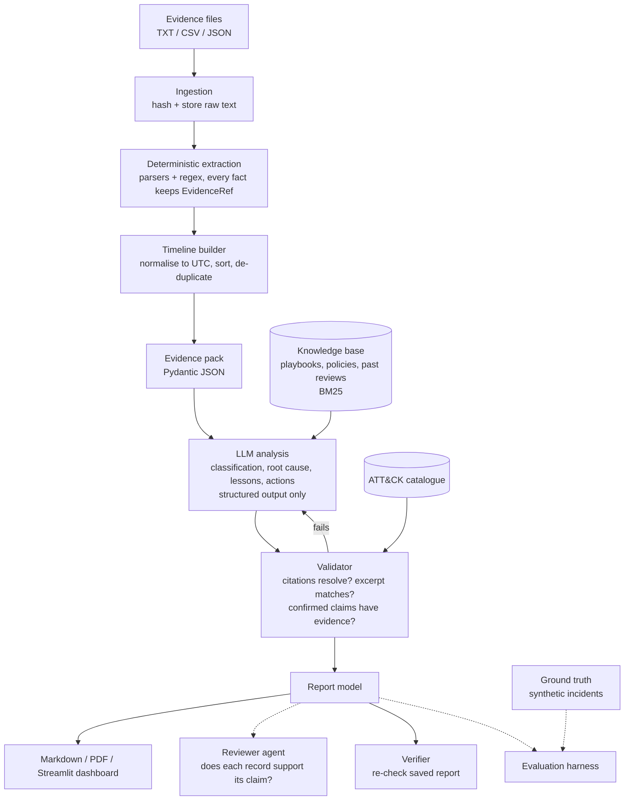

# Architecture

## Core design rule

**Code extracts facts. The LLM only writes about facts it is given.**

Timestamps, IPs, hashes, domains and users are pulled out by parsers and
regex (Phases 2–4). They can be tested, they can't make things up, and you
get exact citations. The LLM gets a structured evidence pack, writes the
narrative parts (summary, root cause wording, lessons), and every claim it
makes is checked against the evidence before it reaches the report.

If the LLM is allowed to extract IOCs from raw logs, it will sometimes invent
or change them. In a security report that's the worst possible failure.

## Pipeline



## Module ## Module map

| Module | Phase | Purpose |
|---|---|---|
| `schemas.py` | 1 | Data contract and safety rules (Pydantic) |
| `provenance.py` | 1 | Resolve a citation to its source record |
| `samples.py` | 1 | Load synthetic incidents and answer keys |
| `ingest.py` | 2 | Read TXT/CSV/JSON, hash files, split into citable records |
| `extract.py` | 3 | Observables by regex, known fields and cross-source linking |
| `timeline.py` | 4 | UTC ordering, date inference, duplicate merging |
| `evaluate.py`, `variants.py` | 4, 12 | Timeline and report scoring; messy evidence variants |
| `evidence_pack.py`, `llm.py`, `postmortem.py` | 5 | Evidence pack, Anthropic client, generation, Markdown report |
| `validate.py` | 5, 8, 9 | Draft checks while generating: citations, quotes, certainty, IOCs, ATT&CK, impact, milestones |
| `kb.py`, `abtest.py` | 6 | Policy retrieval (BM25) and A/B summaries |
| `attack.py` | 7 | Official ATT&CK catalogue and ID checks |
| `verify.py` | 9 | Independent re-check of saved reports |
| `dashboard_data.py`, `streamlit_app.py` | 10 | Dashboard (demo mode) |
| `pdf.py` | 11 | Incident PDF export |
| `evalsuite.py` | 12 | The 10 evaluation measures across saved runs |
| `agents.py` | 13 | Reviewer agent, planted-error benchmark, pipeline trace |
| `report_pdf.py` | 14 | Technical report PDF from Markdown |

Not built (see the technical report, section 14): PDF/DOCX evidence input, a FastAPI backend,
a database, embeddings, and evidence upload in the dashboard.

ion (Phase 3): observables, not IOCs

Extraction finds every observable: IPs, domains, URLs, emails, hashes, users,
hosts, processes, file paths, cloud resources and timestamps. It does **not**
decide what is malicious. The company's own domain and its VPN IP are
extracted too. Labelling something an IOC is analysis, done later with context.

Three methods, each recorded on the entity:

| Method | Finds | Example |
|---|---|---|
| `regex` | IPs, URLs, domains, emails, hashes, timestamps in text | `203.0.113.45` in an auth log row |
| `field` | known CSV/JSON keys (`user`, `src_host`, `userIdentity.userName`) | `d.reyes` from cloud audit log |
| `known_entity` | users/hosts from structured data, re-found in notes | `j.patel` in "Revoked all active sessions for j.patel" |

Precision guards:
- A bare `word.word` counts as a domain only if it ends in a known TLD. Without
  this, `j.patel`, `upd.dll` and `powershell.exe` all become domains.
- IPs are validated (`999.1.1.1` is rejected) and tagged with a scope:
  public, private, documentation, loopback or link_local.
- URLs stop at quotes, commas and trailing punctuation.
- Timestamps with a timezone are converted to UTC. Timestamps without one are
  **flagged, not assumed to be UTC**. Time-only values (`09:52`) are flagged
  for Phase 4 to resolve.

Known limits:
- Defanged indicators (`hxxp://`, `evil[.]com`) are not handled.
- The TLD list is short; swap in the public suffix list for real data.
- Relative times ("Next day 09:30") are not extracted.
- Users who appear only as email recipients (`a.khan`) aren't linked as users.

## Timeline (Phase 4)

- One event per evidence record that has a timestamp.
- **Time-only notes** (`09:52 Revoked sessions`) take their date from the other
  evidence. If the evidence covers one day: confidence 0.8. If it covers
  several days: the latest day is used, confidence drops to 0.4, and a
  warning is raised.
- **No timezone:** assumed UTC and recorded as `time_basis = timezone_assumed`.
- **Duplicates across logs** (EDR + proxy for the same connection) are merged
  into one event with both sources, only if they are within 2 seconds, share
  an IP/URL/domain/hash/email, and don't name different users (or different
  hosts). A user in one log and a host in the other is not a conflict.
- Descriptions are mechanical (`rule=Impossible travel; user=j.patel`).
  Readable wording is Phase 5's job.

Known limits:
- "Next day 09:30" (relative dates) is not handled.
- A note and a log line describing the same action at slightly different
  times (`11:22` in the ticket, `11:22:04` in EDR) stay as two events.

## Evaluation (Phase 4, basic)

`python -m pmgen.evaluate` scores timelines against ground truth on the 3
incidents and 5 messy variants of each (18 cases):

| Variant | What it adds |
|---|---|
| shuffled | CSV rows in random order (ground truth row numbers rewritten) |
| noisy | 3 benign rows per CSV |
| offset_tz | one log source in +05:30 instead of UTC |
| dup_alert | an alert duplicated in the JSON export |
| combined | all of the above |

Current result: 100% key-event recall, timestamp accuracy and order accuracy
on all 18 cases; average 1.6 timeline events per key event.

**How to read that number:** these metrics check that the deterministic
pipeline orders and times events correctly. They are close to a unit test, not
a benchmark. Matching uses the source record, so recall means "every key
record became an event", not "the system knew which events mattered". That
harder question (and the LLM's accuracy) is measured from Phase 5 onwards.
The scorer itself is tested: sabotaging a timeline lowers all three scores.

## LLM postmortem (Phase 5)

The LLM sees only the evidence pack: every record numbered (R001...), the
code-built timeline (EV001...), and the extracted observables. It never sees
the ground truth. It returns a JSON draft. How the JSON is obtained was changed twice after
real API runs:

| Attempt | Result on claude-sonnet-5-5 |
|---|---|
| Forced tool call (`tool_choice` "tool") | 400: forced tool use not supported by this model |
| Structured outputs (`output_config.format`) | 400: compiled grammar too large for this schema |
| **Schema in the prompt, JSON in `<json>` tags (current default)** | works with any schema size |

The schema is no longer enforced by the API, so the code does it: a reply that
doesn't parse or doesn't match the schema is sent back once with the exact
errors. Structured outputs remain available with `--mode structured`.

**Validation (code, not the LLM):**
1. Every citation must name a real record ID.
2. The quoted text must appear in that record. This stops invented citations.
3. Confirmed/probable findings, lessons and corrective actions need at least one valid citation.
4. Listed indicators must be among the extracted observables.
5. No IP/domain/URL/email/hash may appear anywhere in the text unless it is in the evidence.
6. Key event IDs must exist; lesson areas must be people/process/technology/governance.

If anything fails, the problems are sent back once for a corrected draft.
Anything still failing is **dropped** (claims) or **redacted** (invented
indicators), and every removal is listed in the report's Validation log.
Unverified indicators in the log are defanged (`198[.]51[.]100[.]250`) so they
can't be copied into a blocklist by mistake.

**Summary check (Phase 5b):** the executive summary is a list of points, each
naming the findings it restates (`what_happened[2]`, `root_cause`...). Code
checks the findings exist and survived validation, and if any is not
"confirmed", the point must contain hedging language ("probably", "may", "not
confirmed"). A point that fails is dropped and logged. This targets run 1's
INC-002 overclaim. Limit: it checks for hedging words, not that the point
faithfully restates the finding.

**Known gap:** a correctly quoted citation can still be used to support a
claim it doesn't actually support. Checks 1-3 can't see that. It is measured
with the hallucination-trap list (manual for now) and addressed in Phase 9.

**Report score** (`evaluate.score_report`): category, severity, whether the
root cause cites the right record, contributing-factor recall, indicator
precision and recall, number of claims removed. Tested only with a scripted
fake LLM so far; real-model results come from running it.

## Knowledge base / RAG (Phase 6)

- **Documents:** 13 synthetic company documents in `data/knowledge_base/`:
  policies (identity and MFA, alerting, change and exceptions, data handling,
  endpoint hardening), five playbooks, a severity matrix and two past incident
  reviews.
- **Chunking:** one chunk per `## §n` section, so each chunk is one rule and is
  citable as `POL-07 §3`. 53 sections in total.
- **Retrieval:** BM25 keyword ranking (no dependencies), top 8. The query is
  built from the notes and descriptive log fields (alert names, actions, event
  names); IPs, hashes and names are left out because policies never contain them.
- **Why not embeddings + a vector DB:** at 53 short, term-heavy sections, BM25
  is a strong baseline and a vector database adds setup with no measured gain.
  Embeddings should replace it only if they beat it on `python -m pmgen.kb --eval`.
- **Leak guard:** a test fails if any incident's names, hosts, IPs, domains or
  hashes appear in the knowledge base.
- **Citation rules:** knowledge-base sections (`K01`...) may support corrective
  actions and lessons only. Findings that cite them are rejected. An action that
  cites only policy, with no incident evidence, is dropped. Policy quotes are
  checked against the section text, like evidence quotes.
- **Report:** a "Policy" column in corrective actions and a "Policy and playbook
  references" index, separate from the evidence index.

## MITRE ATT&CK mapping (Phase 7)

- **Catalogue:** `data/attack/enterprise_techniques.json`, built by
  `scripts/build_attack_catalog.py` from MITRE's official `enterprise-attack.json`
  (source URL, SHA-256, download date, version and MITRE's notice stored in the
  file). 867 techniques, 706 active.
- **No list in the prompt:** giving the model a shortlist would leak the answer
  key, so it maps from its own knowledge. A test fails if any answer-key ID
  appears in the prompt or schema.
- **Code checks:** the ID exists and is not revoked or deprecated; certainty is
  confirmed or probable (no "possible" mappings); each mapping cites evidence
  records with exact quotes; knowledge-base citations are rejected; duplicates
  are removed. Names and tactics come from the catalogue, never from the model.
- **Scoring:** strict recall, lenient recall (parent/sub-technique), precision
  against required + acceptable techniques, and forbidden hits (traps).

## Root cause, impact and response timing (Phase 8)

- **Immediate cause vs root cause.** Immediate cause = what directly triggered the
  incident; root cause = the weakness that let it succeed. Both are findings with
  certainty and evidence.
- **Impact.** `systems_involved` / `accounts_involved` must appear in the evidence
  as whole tokens (so `j.pat` does not match `j.patel`); anything else is dropped
  and logged. Data, operational and business impact are findings; "unknown" with
  no citation is allowed (the evidence rarely states cost).
- **The LLM never does time arithmetic.** It picks four timeline event IDs
  (attack start, first detection, response start, containment) or null. Code checks
  they exist and are in time order, then computes time to detect / respond /
  contain and dwell time. A duration is marked approximate if either endpoint's
  date was inferred or its timezone assumed. Bad milestones drop the timing
  section only, not the report.
- **Known limits.** No resolution/recovery time: the evidence does not date it.
  Milestones are judgment calls; the answer key accepts several events where
  analysts could reasonably disagree (e.g. INC-003 attack start = the misconfig or
  the first outside read, 3 days apart, which changes time to detect a lot).

## Validation (Phase 9): two layers

1. **While generating** (`validate.py`): checks the LLM draft, sends problems back
   once, then drops or downgrades what still fails and logs it.
2. **After saving** (`verify.py`): an independent check of the finished report
   against the original evidence files, so a reader does not have to trust that
   layer 1 ran or that the report was not edited. Checks: file SHA-256 hashes,
   citations and quotes, policy quotes, IOCs in their cited record, ATT&CK IDs
   current, milestone order and recomputed durations, impact names in evidence,
   confirmed/probable findings have evidence.

**What neither layer can check:** whether a correctly quoted record supports the
claim's meaning. Two code checks for this were tested offline on saved reports
and rejected (see results.md): too many false alarms, no true catches.

**Known gap:** the code computes durations only in the Response analysis table.
In prose the model still writes gaps itself ("about 45 minutes later"). All that
were spot-checked were right, but they are not verified.

## Dashboard (Phase 10)

- `dashboard_data.py` holds all logic (loading, verification, scoring, table rows)
  with no Streamlit import, so it is unit-tested directly. `streamlit_app.py` only
  displays. Two `AppTest` smoke tests render every tab.
- Demo mode by default: saved JSON reports only. Live LLM generation needs both
  `PMGEN_LIVE=1` and an API key, so a public deployment cannot spend credit.
- Each page re-runs the verifier and the ground-truth scoring live, so the PASS
  badge and scores are computed, not copied from a file.
- Not built yet: uploading new evidence through the app (the evidence must be in
  `data/incidents/` for the verifier to re-read it).

## PDF export (Phase 11)

- `pdf.py` builds the PDF with ReportLab: no browser or Chrome, so it also runs
  on Streamlit Community Cloud. Same content and the same [E#]/[P#] citation
  numbers as the Markdown report, so a reader can move between the two.
- Title page with metadata, the DRAFT banner and the verifier result; a timeline
  chart drawn directly (blue = exact time, amber = inferred); tables for the
  timeline, IOCs, ATT&CK, impact, response timing and actions; references with
  evidence quotes, policy quotes, file hashes and the validation log; "Page X of Y".
- Built-in PDF fonts cover Latin-1 only, so a few symbols are mapped (-> for
  arrows) and anything else becomes "?". All text is XML-escaped, so model output
  cannot inject formatting.
- Light layout on purpose: it is meant to be printed and read, unlike the dark dashboard.

## Evaluation suite (Phase 12)

`python -m pmgen.evalsuite RUN_FOLDER ...` computes the spec's 10 measures from
saved reports (no API calls) and writes `docs/evaluation.md`. Each folder is one run.

| Measure | Source | Kind |
|---|---|---|
| Extraction, timeline | code on 36 cases (6 incidents x 6 variants) | exact |
| Classification, ATT&CK, root cause, milestones, scope | answer keys | exact |
| Citation correctness | the independent verifier | exact |
| Unsupported claim rate | validation logs: removed / all claims | only what the validator caught |
| Severity consistency | same answer across runs (values, not correctness) | needs 2+ runs |
| Recommendation relevance | action cites a record behind a finding | **proxy** |
| Completeness | 13-item section checklist | exact |

Hallucination traps stay a manual check (a statement can cite a real record and
still misread it). Found while building this: a dropped indicator was never logged
as DROPPED, so "claims removed" undercounted it in earlier phases. Fixed in the
validator; older logs are counted from their final unresolved problem lines.

## Multi-agent version (Phase 13)

Only one stage was turned into a new agent, because only one gap needed it.

```
ingest -> extract -> timeline -> KB retrieval   code
draft + validate                                LLM + code (existing)
review                                          LLM (new): does the cited record support the claim?
verify                                          code
```

- **Why only one:** every other stage is deterministic code that is already
  tested. Making them LLM calls would add cost and failure modes with no gain.
- **Reviewer agent:** sees each factual claim with its stated certainty and the
  full text of the records it cites, never the draft's reasoning. Verdict:
  supported / overstated / unsupported. **It only flags**: nothing is changed or
  deleted automatically; a human decides.
- **Benchmark with planted errors:** known errors that keep real citations, so
  every code check passes and only reading for meaning catches them: certainty
  raised from probable to confirmed; a statement moved onto unrelated citations;
  an account, host or IP swapped for another one from the same evidence (like for
  like). Claims are shuffled and given neutral IDs, so the reviewer cannot tell
  which are planted.
- **Trace:** every stage logs seconds, tokens and estimated cost.
- **Limits:** the reviewer is the same model family as the drafter; the planted
  errors are simple; a certainty plant may turn out to be genuinely supported, in
  which case "supported" is right and the plant was wrong; flagged original claims
  need a human to judge, they are not automatically false alarms.

## Safety rules enforced in code (not just in prompts)

- A `confirmed` timeline event must cite evidence and have a timestamp.
- An `inferred` event must give a rationale.
- An `unknown` event can't have confidence above 0.5.
- `confirmed` or `probable` findings must cite evidence.
- An ATT&CK mapping must cite evidence and use a valid ID format.
- Every corrective action must cite supporting evidence.
- Timestamps without a timezone are rejected.

## Locator format (citations)

| File type | Locator | Example |
|---|---|---|
| CSV | `row N` (1-based, header excluded) | `auth_logs.csv / row 2` |
| TXT | `line N` (1-based; blank lines not citable) | `analyst_notes.txt / line 8` |
| JSON | `key[i]`, `[i]` (top-level list), `meta` (top-level fields) | `siem_alerts.json / alerts[1]` |
| PDF/DOCX | `page N para M` | deferred (after Phase 5) |

## Synthetic incidents

| ID | Scenario | What it tests |
|---|---|---|
| INC-2026-001 | Phishing, then mailbox takeover and forwarding rule | Joining events across 5 sources; trap: SharePoint access is suspected but not checked |
| INC-2026-002 | Macro document, then PowerShell, DLL and C2 beacon | No email log is included, so T1566 must **not** be mapped; trap: lateral movement |
| INC-2026-003 | Public storage bucket exposing customer data | Detection by an outside party; trap: who owns the downloading IP |

All IPs are in reserved documentation ranges (RFC 5737). All domains end in
`.test` or `.example`. The hashes are SHA-256 of placeholder strings.
None of them are real indicators.
