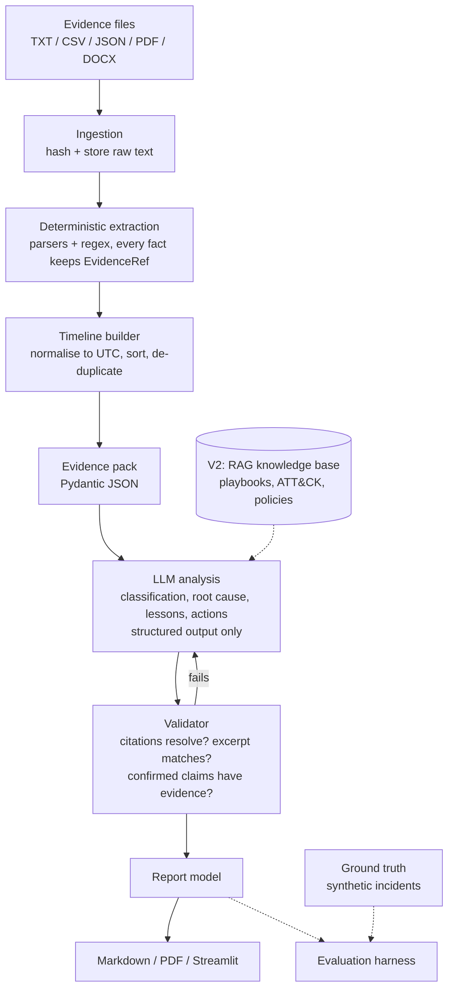

# Architecture (Phase 1)

## Core design rule

**Code extracts facts. The LLM only writes about facts it is given.**

Timestamps, IPs, hashes, domains and users are pulled out by parsers and
regex (Phases 2–4). They can be tested, they can't make things up, and you
get exact citations. The LLM gets a structured evidence pack, writes the
narrative parts (summary, root cause wording, lessons), and every claim it
makes is checked against the evidence before it reaches the report.

If the LLM is allowed to extract IOCs from raw logs, it will sometimes invent
or change them. In a security report that's the worst possible failure.

## Pipeline

## Module map

| Module | Phase | Status |
|---|---|---|
| `schemas.py` — data contract plus safety rules | 1 | Done |
| `provenance.py` — resolve a citation to its source record | 1 | Done |
| `samples.py` — load synthetic incidents and ground truth | 1 | Done |
| `ingest.py` — read TXT/CSV/JSON, hash, split into citable records | 2 | Done (PDF/DOCX deferred) |
| `extract.py` — regex, field mapping, cross-source user/host linking | 3 | Done |
| `timeline.py` — order, date-fill, merge duplicates | 4 | Done |
| `evidence_pack.py`, `llm.py`, `postmortem.py` — LLM draft + Markdown report | 5 | Done |
| `validate.py` — claim vs evidence checks | 5 (basic), 9 (full) | Basic done |
| Markdown report (5), PDF (11) | 5, 11 | Markdown done |
| `evaluate.py` + `variants.py` — timeline scoring on clean and messy data | 4 (basic), 12 (full) | Basic done |

## Extraction (Phase 3): observables, not IOCs

Extraction finds every observable: IPs, domains, URLs, emails, hashes, users,
hosts, processes, file paths, cloud resources and timestamps. It does **not**
decide what is malicious. The company's own domain and its VPN IP are
extracted too. Labelling something an IOC is analysis, done later with context.

Three methods, each recorded on the entity:

| Method | Finds | Example |
|---|---|---|
| `regex` | IPs, URLs, domains, emails, hashes, timestamps in text | `203.0.113.45` in an auth log row |
| `field` | known CSV/JSON keys (`user`, `src_host`, `userIdentity.userName`) | `d.reyes` from cloud audit log |
| `known_entity` | users/hosts from structured data, re-found in notes | `j.patel` in "Revoked all active sessions for j.patel" |

Precision guards:
- A bare `word.word` counts as a domain only if it ends in a known TLD. Without
  this, `j.patel`, `upd.dll` and `powershell.exe` all become domains.
- IPs are validated (`999.1.1.1` is rejected) and tagged with a scope:
  public, private, documentation, loopback or link_local.
- URLs stop at quotes, commas and trailing punctuation.
- Timestamps with a timezone are converted to UTC. Timestamps without one are
  **flagged, not assumed to be UTC**. Time-only values (`09:52`) are flagged
  for Phase 4 to resolve.

Known limits:
- Defanged indicators (`hxxp://`, `evil[.]com`) are not handled.
- The TLD list is short; swap in the public suffix list for real data.
- Relative times ("Next day 09:30") are not extracted.
- Users who appear only as email recipients (`a.khan`) aren't linked as users.

## Timeline (Phase 4)

- One event per evidence record that has a timestamp.
- **Time-only notes** (`09:52 Revoked sessions`) take their date from the other
  evidence. If the evidence covers one day: confidence 0.8. If it covers
  several days: the latest day is used, confidence drops to 0.4, and a
  warning is raised.
- **No timezone:** assumed UTC and recorded as `time_basis = timezone_assumed`.
- **Duplicates across logs** (EDR + proxy for the same connection) are merged
  into one event with both sources, only if they are within 2 seconds, share
  an IP/URL/domain/hash/email, and don't name different users (or different
  hosts). A user in one log and a host in the other is not a conflict.
- Descriptions are mechanical (`rule=Impossible travel; user=j.patel`).
  Readable wording is Phase 5's job.

Known limits:
- "Next day 09:30" (relative dates) is not handled.
- A note and a log line describing the same action at slightly different
  times (`11:22` in the ticket, `11:22:04` in EDR) stay as two events.

## Evaluation (Phase 4, basic)

`python -m pmgen.evaluate` scores timelines against ground truth on the 3
incidents and 5 messy variants of each (18 cases):

| Variant | What it adds |
|---|---|
| shuffled | CSV rows in random order (ground truth row numbers rewritten) |
| noisy | 3 benign rows per CSV |
| offset_tz | one log source in +05:30 instead of UTC |
| dup_alert | an alert duplicated in the JSON export |
| combined | all of the above |

Current result: 100% key-event recall, timestamp accuracy and order accuracy
on all 18 cases; average 1.6 timeline events per key event.

**How to read that number:** these metrics check that the deterministic
pipeline orders and times events correctly. They are close to a unit test, not
a benchmark. Matching uses the source record, so recall means "every key
record became an event", not "the system knew which events mattered". That
harder question (and the LLM's accuracy) is measured from Phase 5 onwards.
The scorer itself is tested: sabotaging a timeline lowers all three scores.

## LLM postmortem (Phase 5)

The LLM sees only the evidence pack: every record numbered (R001...), the
code-built timeline (EV001...), and the extracted observables. It never sees
the ground truth. It returns a structured draft through a forced tool call.

**Validation (code, not the LLM):**
1. Every citation must name a real record ID.
2. The quoted text must appear in that record. This stops invented citations.
3. Confirmed/probable findings, lessons and corrective actions need at least one valid citation.
4. Listed indicators must be among the extracted observables.
5. No IP/domain/URL/email/hash may appear anywhere in the text unless it is in the evidence.
6. Key event IDs must exist; lesson areas must be people/process/technology/governance.

If anything fails, the problems are sent back once for a corrected draft.
Anything still failing is **dropped** (claims) or **redacted** (invented
indicators), and every removal is listed in the report's Validation log.
Unverified indicators in the log are defanged (`198[.]51[.]100[.]250`) so they
can't be copied into a blocklist by mistake.

**Known gap:** a correctly quoted citation can still be used to support a
claim it doesn't actually support. Checks 1-3 can't see that. It is measured
with the hallucination-trap list (manual for now) and addressed in Phase 9.

**Report score** (`evaluate.score_report`): category, severity, whether the
root cause cites the right record, contributing-factor recall, indicator
precision and recall, number of claims removed. Tested only with a scripted
fake LLM so far; real-model results come from running it.

## Safety rules enforced in code (not just in prompts)

- A `confirmed` timeline event must cite evidence and have a timestamp.
- An `inferred` event must give a rationale.
- An `unknown` event can't have confidence above 0.5.
- `confirmed` or `probable` findings must cite evidence.
- An ATT&CK mapping must cite evidence and use a valid ID format.
- Every corrective action must cite supporting evidence.
- Timestamps without a timezone are rejected.

## Locator format (citations)

| File type | Locator | Example |
|---|---|---|
| CSV | `row N` (1-based, header excluded) | `auth_logs.csv / row 2` |
| TXT | `line N` (1-based; blank lines not citable) | `analyst_notes.txt / line 8` |
| JSON | `key[i]`, `[i]` (top-level list), `meta` (top-level fields) | `siem_alerts.json / alerts[1]` |
| PDF/DOCX | `page N para M` | deferred (after Phase 5) |

## Synthetic incidents

| ID | Scenario | What it tests |
|---|---|---|
| INC-2026-001 | Phishing, then mailbox takeover and forwarding rule | Joining events across 5 sources; trap: SharePoint access is suspected but not checked |
| INC-2026-002 | Macro document, then PowerShell, DLL and C2 beacon | No email log is included, so T1566 must **not** be mapped; trap: lateral movement |
| INC-2026-003 | Public storage bucket exposing customer data | Detection by an outside party; trap: who owns the downloading IP |

All IPs are in reserved documentation ranges (RFC 5737). All domains end in
`.test` or `.example`. The hashes are SHA-256 of placeholder strings.
None of them are real indicators.
